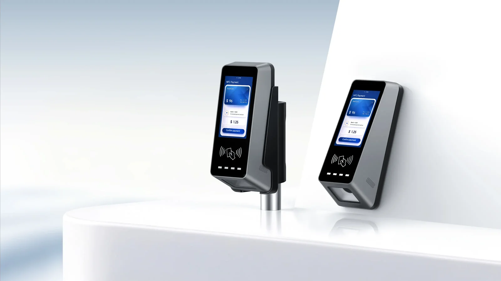
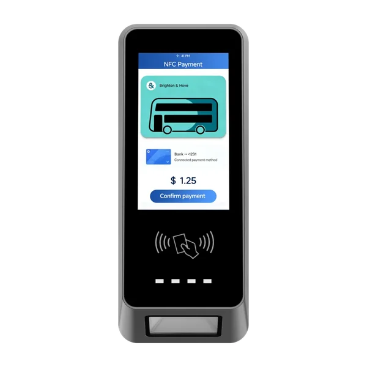
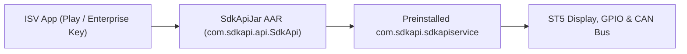

<div align="center">
  <a href="https://www.suntekai.com">
    <picture>
      <source media="(prefers-color-scheme: dark)" srcset="https://raw.githubusercontent.com/SUNTEK-Official/.github/main/profile/assets/logo-dark.png">
      <source media="(prefers-color-scheme: light)" srcset="https://raw.githubusercontent.com/SUNTEK-Official/.github/main/profile/assets/logo-light.png">
      
    </picture>
  </a>

  <h1>SUNTEK ST5 Android POS & Ticket Validator SDK</h1>

  <p>
    <strong>Official Hardware SDK &amp; Developer Kit</strong> &middot; <em>Enjoy Smarter Service</em><br>
    Official Android 14 system, dual-display, display scaler, and CAN bus integration SDK for <strong>SUNTEK ST5</strong> smart POS and transit ticket validator terminals (<strong>SUNTEK Technology Co., Ltd.</strong>).
  </p>

  <p>
    <a href="./LICENSE"></a>
    <a href="https://github.com/SUNTEK-Official/suntek-sdk-st5/releases"></a>
    
    <a href="https://www.suntekai.com/products/ticket-validator-st5/"></a>
    <a href="mailto:support@suntekai.com"></a>
  </p>

  <p>
    <a href="#hardware-showcase--compatibility">Hardware</a> &nbsp;&bull;&nbsp;
    <a href="#architecture--key-capabilities">Architecture</a> &nbsp;&bull;&nbsp;
    <a href="#supported-interfaces--physical-connections">Interfaces</a> &nbsp;&bull;&nbsp;
    <a href="#5-minute-quick-start">Quick Start</a> &nbsp;&bull;&nbsp;
    <a href="#sample-apps--prebuilt-downloads">Downloads</a> &nbsp;&bull;&nbsp;
    <a href="#troubleshooting--faq">FAQ</a> &nbsp;&bull;&nbsp;
    <a href="#documentation-changelog--support">Support</a>
  </p>
  
</div>

---

## Hardware Showcase & Compatibility

<table>
  <tr>
    <td align="center" width="38%">
      <a href="https://www.suntekai.com/products/ticket-validator-st5/">
        
      </a>
      <br>
      <strong>ST5</strong><br>
      <sub>Android 14 Smart Terminal & Validator</sub><br>
      <a href="https://www.suntekai.com/products/ticket-validator-st5/">Official Product Page</a>
    </td>
    <td valign="top" width="62%">
      <ul>
        <li><strong>Platform</strong>: Rockchip RK3576 &middot; Android 14</li>
        <li><strong>Display Control</strong>: Dual-display rotation, PWM backlight &amp; display scaler interface (<code>ApiScale</code>)</li>
        <li><strong>Industrial Bus</strong>: Integrated CAN bus (<code>/dev/can0</code>) and RS-232/RS-485 UART ports</li>
        <li><strong>Security</strong>: Standard release app signing via preinstalled IPC</li>
      </ul>
    </td>
  </tr>
</table>

| Product Model | Chipset / Board | OS Versions | Build Identifier | Status |
| :--- | :--- | :--- | :--- | :---: |
| **ST5** | Rockchip RK3576 | Android 14 | `ST5-3576*` | Supported |

> [!IMPORTANT]
> Verify your device **Model** and **Build Number** under Android **Settings -> About device** before integration. Customer applications use your own Google Play or enterprise release certificate.

---

## Architecture & Key Capabilities

- **Dual-Display & Validator Hardware Control**: Complete Java APIs for customer display control, PWM backlight, watchdog, and hardware LED indicators.
- **CAN Bus & RS-232/RS-485 Control**: Programmatic port power management and UART/CAN communication via `ApiHardware`.
- **Zero-ROM-Change IPC**: Directly binds to preinstalled `com.sdkapi.sdkapiservice` using your Google Play or enterprise signing key.



---

## Supported Interfaces & Physical Connections

| Hardware Feature | Interface Type | Device Path / Service Target | Notes |
| :--- | :--- | :--- | :--- |
| **Preinstalled System IPC** | Binder Service (`com.sdkapi`) | `com.sdkapi.sdkapiservice` | Display, hardware I/O, silent install, watchdog |
| **Display Scaler Interface** | ApiScale (`Touchpoint Chip Control`) | `ApiScale / ScaleListener` | Display scaler chip setup and event callbacks |
| **CAN & Serial Control** | ApiHardware Interface | `/dev/ttyS0 .. /dev/can0` | RS232/RS485/TTL port power switch & CAN frames |

---

## Repository Directory Layout

```text
suntek-sdk-st5/
├── assets/                 # Hero banner & ST5 product renders
├── sdk/
│   └── SdkApiJar_V1.260410.0350.aar
├── docs/
│   └── st5-system-and-hardware-api.md
├── sample-android/         # Android Studio sample (com.suntek.sample.st5)
├── README.md
├── LICENSE
├── THIRD_PARTY_NOTICES.md
└── CHANGELOG.md
```

> All installers (`.exe`), compiled sample APKs (`.apk`), and large binary packages (> 5 MB) are hosted on [**GitHub Releases**](https://github.com/SUNTEK-Official/suntek-sdk-st5/releases) with `SHA256SUMS.txt`.

---

## Prerequisites & Permissions

- **Platform Target**: `minSdk 26` / `targetSdk 35`
- **App Signing Requirement**: Customer apps use your own Google Play or enterprise release key (IPC via `com.sdkapi.sdkapiservice`). No platform key is required.
- **Required Permissions / Capabilities**: Standard runtime permissions; `<queries>` for `com.sdkapi.sdkapiservice` bundled inside AAR.

---

## 5-Minute Quick Start

### Step 1: Add AAR Dependency

```gradle
dependencies {
    implementation files('libs/SdkApiJar_V1.260410.0350.aar')
}
```

### Step 2: Initialize SDK & Query System Info

```java
import com.sdkapi.api.SdkApi;

SdkApi.newInstance(getApplicationContext());
if (SdkApi.getInstance() != null) {
    String chip = SdkApi.getInstance().DeviceInfo().getChipName();
    String fw = SdkApi.getInstance().DeviceInfo().getFirmwareVersion();
}
```

### Build & Run Sample Project

```bash
cd sample-android && ./gradlew assembleDebug
```

---

## Sample Apps & Prebuilt Downloads

Verified prebuilt APKs, offline SDK bundles, and checksum manifests are published on [**GitHub Releases**](https://github.com/SUNTEK-Official/suntek-sdk-st5/releases). Verify downloaded archives before production deployment:

```bash
shasum -a 256 -c SHA256SUMS.txt
```

---

## Troubleshooting & FAQ

<details>
<summary><b>Which certificate signs applications running on ST5?</b></summary>
<p>Sign with your own Google Play or enterprise release key; hardware I/O and CAN interfaces communicate via preinstalled system services (`com.sdkapi.sdkapiservice`). Companion `SuntekBridgeService.apk` is also available in Releases for elevated system operations.</p>
</details>

<details>
<summary><b>Where is the detailed ST5 System & CAN API reference?</b></summary>
<p>See `docs/st5-system-and-hardware-api.md` for complete display, GPIO, CAN bus, and hardware interface documentation.</p>
</details>

---

## Documentation, Changelog & Support

- **Changelog**: [CHANGELOG.md](./CHANGELOG.md)
- **Developer Documentation Portal**: [suntek-docs](https://github.com/SUNTEK-Official/suntek-docs)
- **Technical Support**: [support@suntekai.com](mailto:support@suntekai.com)
- **Bug Reports**: [Open an Issue](https://github.com/SUNTEK-Official/.github/issues/new/choose)
- **Security Disclosures**: See [SECURITY.md](https://github.com/SUNTEK-Official/.github/blob/main/SECURITY.md) or email [support@suntekai.com](mailto:support@suntekai.com)

---

<div align="center">
  
  <br><br>
  <strong>SUNTEK Technology Co., Ltd.</strong> &mdash; <em>Smart Commercial Terminal Hardware Manufacturer Since 2010</em><br>
  <sub>80+ Export Countries &middot; 5,000,000+ Terminals Shipped &middot; 500+ ODM Projects &middot; ISO 9001 / ISO 14001 / ISO 27001 / CE / RoHS</sub><br>
  <sub><a href="https://www.suntekai.com">www.suntekai.com</a> &middot; Copyright &copy; 2026 SUNTEK Technology Co., Ltd. All rights reserved.</sub>
</div>
