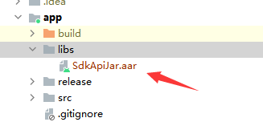
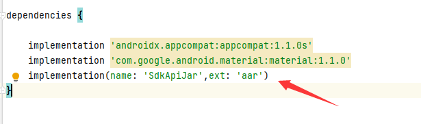
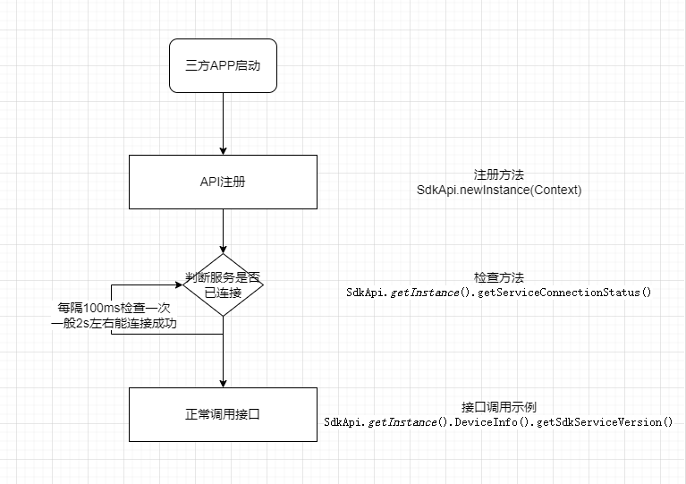
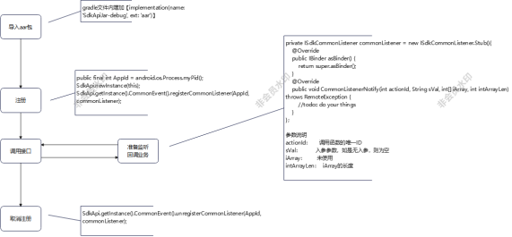

# ST5 SdkApi

Android SDK for the ST5 embedded platform, providing system-level APIs for display control, hardware I/O, display scaler chip control, power management, and device administration.

## Overview

The **ST5 SdkApi** (`com.sdkapi`) is an Android library (AAR) that exposes low-level hardware and system capabilities of ST5-series smart terminal devices. It communicates with a privileged system service (`com.sdkapi.sdkapiservice`) via AIDL-based IPC, allowing third-party applications to access device-specific functionality that is not available through the standard Android SDK.

| Property          | Value                        |
| ----------------- | ---------------------------- |
| Version           | `4.1.0.260410.0350`          |
| Package           | `com.sdkapi`                 |
| Min SDK           | API 19 (Android 4.4)         |
| Target SDK        | API 30 (Android 11)          |
| Artifact          | `SdkApiJar_V1.260410.0350.aar` |
| System Service    | `com.sdkapi.sdkapiservice`   |

## Architecture

```
┌──────────────────────────────┐
│  Your Application            │
│  (uses com.sdkapi.*)         │
└─────────────┬────────────────┘
              │ AIDL IPC
┌─────────────▼────────────────┐
│  SdkApi Service              │
│  (com.sdkapi.sdkapiservice)  │
│  ─ system-privileged app     │
└─────────────┬────────────────┘
              │ JNI / sysfs / kernel
┌─────────────▼────────────────┐
│  ST5 Hardware & Peripherals  │
│  (Display, GPIO, Scale, ...) │
└──────────────────────────────┘
```

The SDK uses a **singleton** pattern. Obtain the instance via `SdkApi.newInstance(context)`, then access individual API modules through getter methods:

```java
SdkApi.newInstance(context);
SdkApi sdkApi = SdkApi.getInstance();

// Access API modules
sdkApi.Display().setBrightness(screen, brightness);
sdkApi.Hardware().setGpioOutput(pin, value, true);
sdkApi.SystemCtrl().deviceReboot();
```

## API Modules

### 1. Display (`ApiDisplay`)

Controls screen parameters including rotation, brightness, LVDS configuration, resolution, and backlight.

| Method                        | Description                            |
| ----------------------------- | -------------------------------------- |
| `setScreenRotate(screen, rotate)` | Set screen rotation angle          |
| `getScreenRotate(screen, cb)`     | Get current screen rotation        |
| `setScreenOnoff(screen, onoff)`   | Turn screen on/off                 |
| `setBrightness(screen, level)`    | Set backlight brightness           |
| `getBrightness(screen, cb)`       | Get current brightness             |
| `setBacklightInverse(screen, inv)`| Invert backlight polarity          |
| `setBacklightPWM(screen, freq, duty)` | Configure PWM backlight       |
| `setResolution(screen, res)`      | Change display resolution          |
| `getSupportedResolutionsList(screen)` | List supported resolutions    |
| `setLvdsMode(screen, mode)`       | Set LVDS mode                      |
| `setLvdsSwap(screen, swap)`       | Swap LVDS lanes                    |
| `setLvdsChannel(screen, channel)` | Set LVDS channel count             |
| `setCustomTiming(timing)`         | Apply custom display timings       |
| `setCustomMipiCmds(cmds, len)`    | Send custom MIPI commands          |
| `setScreenGraphicDisplay(...)`    | Configure graphic display params   |
| `switchLvdsToVbyOne(enable)`      | Switch between LVDS and V-by-One   |
| `setVbyOneSignal(enable)`         | Enable/disable V-by-One signal     |

### 2. Hardware (`ApiHardware`)

Provides GPIO, serial port, CAN bus, flash storage, USB power, and peripheral LED control.

| Method                          | Description                          |
| ------------------------------- | ------------------------------------ |
| `getGpioInput(chip, pin)`       | Read GPIO input state                |
| `setGpioOutput(chip, pin, val)` | Set GPIO output level                |
| `flashRead(type, addr, cb)`     | Read from flash storage              |
| `flashWrite(type, addr, data, cb)` | Write to flash storage            |
| `flashReadAddr(type, type2, addr, cb)` | Read flash with address type  |
| `flashWriteAddr(type, type2, addr, data, cb)` | Write flash with address type |
| `setRunningLedOnoff(onoff, cb)` | Toggle running status LED            |
| `setKeyBoardLedROnoff(onoff, cb)` | Toggle keyboard red LED            |
| `setKeyBoardLedGOnoff(onoff, cb)` | Toggle keyboard green LED          |
| `setSpeakerConfigsSave(onoff, vol, mode)` | Configure speaker            |
| `openSerial(dev, baud, ...)`    | Open serial port                     |
| `closeSerial(fd)`               | Close serial port                    |
| `readSerial(fd, buf, len)`      | Read from serial port                |
| `writeSerial(fd, buf, len)`     | Write to serial port                 |
| `setSerialPortOnOff(dev, onoff)`| Enable/disable serial port           |
| `canBusConfigUp(channel)`       | Configure CAN bus                     |
| `canOpen(channel)`              | Open CAN bus channel                  |
| `canSend(fd, id, len, data, flag)` | Send CAN frame                    |
| `canRecv(fd, ids)`              | Receive CAN frame                     |
| `canClose(fd)`                  | Close CAN bus channel                 |
| `mcuRead(addr, buf, len)`       | Read from MCU                        |
| `mcuWrite(addr, buf, len)`      | Write to MCU                         |
| `setUsbPortPowerOnoff(port, onoff)` | Toggle USB port power            |
| `getUsbPortNumber(vid, pid)`    | Get USB port number by VID/PID       |
| `getRcuState()` / `setRcuState(state)` | Remote control unit state    |

### 3. Scale (`ApiScale`)

Interface for display scaler chip control (panel scaling & touchpoint controller events).

| Method                                              | Description                      |
| --------------------------------------------------- | -------------------------------- |
| `registerScaleListener(appId, listener)`             | Register display scaler event listener    |
| `unregisterScaleListener(appId)`                     | Unregister display scaler listener        |
| `setScaleEvent(appId, event, data, args, argsLen)`   | Send display scaler control event            |

### 4. System Control (`ApiSystemCtrl`)

System-level operations: reboot, screenshot, standby, silent APK install, UI bar control, network, camera, and touch configuration.

| Method                          | Description                          |
| ------------------------------- | ------------------------------------ |
| `deviceReboot()`                | Reboot the device                    |
| `setDeviceShallowOnoff(onoff)`  | Enter/exit shallow standby           |
| `setDeviceDeepStandby()`        | Enter deep standby mode              |
| `setDeviceDeepStandby(delay)`   | Deep standby with delay (seconds)    |
| `shotScreen(path, quality, cb)` | Capture screenshot                   |
| `shotHdmiInScreen(path, cb)`    | Capture HDMI input screenshot        |
| `silentInstallApk(path, reboot, cb)` | Silently install APK            |
| `silentUninstallApk(pkg, cb)`   | Silently uninstall APK               |
| `silentInstallApkForPackage(...)` | Install APK with package name      |
| `formatStorageDevice(type, cb)` | Format storage device                |
| `recoverySystem(mode)`          | Trigger system recovery              |
| `setFanOnoff(onoff)`            | Control cooling fan                  |
| `setBootVideoVolume(vol)`       | Set boot video volume                |
| `setStatusBarDisplay(show)`     | Show/hide status bar                 |
| `setStatusBarDisplay2(show)`    | Show/hide secondary status bar       |
| `setNavigationBar(show)`        | Show/hide navigation bar             |
| `setStatusBarDragDown(enable)`  | Enable/disable status bar pull-down  |
| `setNavigationBarSwipeUp(enable)` | Enable/disable nav bar swipe-up   |
| `setStatusBarState(mode, enable, duration)` | Configure status bar state |
| `setNavigationBarState(mode, enable, duration)` | Configure nav bar state |
| `setSystemBarDisplayNotStore(mode)` | Set bar display without persisting |
| `setNetworkPriority(ifaces[])`  | Set network interface priority       |
| `resetUpTime(time)`             | Reset system uptime                  |
| `setNtpServerAddress(addr)`     | Configure NTP server                 |
| `setCameraOrientation(deg)`     | Set camera orientation               |
| `setCameraFacing(dir)`          | Set camera facing direction          |
| `setTouchOrientation(deg)`      | Set touch panel orientation          |
| `setTouchState(id, cfg1, cfg2, state)` | Configure touch device         |
| `getTPLastTouchTime()`          | Get last touch panel event time      |

### 5. System Time (`ApiSystemTime`)

| Method                    | Description                  |
| ------------------------- | ---------------------------- |
| `setSystemTime(millis)`   | Set system clock (epoch ms)  |
| `getRtcTime()`            | Get RTC time string          |
| `setAutoTimeOnoff(onoff)` | Enable/disable auto time sync|
| `getAutoTimeOnoff()`      | Get auto time sync state     |

### 6. Timer Switch (`ApiTimerOnoff`)

Scheduled power on/off control with support for weekly schedules and delayed actions.

| Method                                  | Description                       |
| --------------------------------------- | --------------------------------- |
| `setTimerSwitchOnoff(onoff)`            | Enable/disable timer switch        |
| `setTimerOnTime(time)` / `clearTimerOnTime()`  | Set/clear daily power-on time |
| `setTimerOffTime(time)` / `clearTimerOffTime()`| Set/clear daily power-off time|
| `setTimerOnYmdTime(ymdTime)`            | Set one-shot power-on date & time  |
| `setTimerOffYmdTime(ymdTime)`           | Set one-shot power-off date & time |
| `setTimerType(type)`                    | Set timer type (daily/once)        |
| `setPowerOnOffWithWeekly(onWeeks, offWeeks, hours)` | Weekly schedule     |
| `setDelayedPowerOffTime(millis)`        | Set delayed power-off countdown    |
| `setDelayedPowerOnTime(millis)`         | Set delayed power-on countdown     |
| `setTimerStandbyMode(mode)`             | Set standby mode for timer         |

### 7. Watchdog (`ApiWatchdog`)

Hardware watchdog timer for system reliability.

| Method                      | Description                        |
| --------------------------- | ---------------------------------- |
| `setWatchdogOnoff(onoff)`   | Enable/disable hardware watchdog   |
| `setWatchdogTimeout(sec)`   | Set watchdog timeout in seconds    |
| `feedWatchdog()`            | Feed the watchdog (reset timer)    |

### 8. Device Info (`ApiDeviceInfo`)

Read and configure device identification, firmware, and system properties.

| Method                        | Description                        |
| ----------------------------- | ---------------------------------- |
| `getApiVersion()`             | Get SDK API version                |
| `getApiSdkServiceVersion()`   | Get backend service version        |
| `getFirmwareVersion()`        | Get device firmware version        |
| `getChipName()`               | Get SoC/chipset name               |
| `getSerialNumber()`           | Get device serial number           |
| `setSerialNumber(sn)`         | Set device serial number           |
| `getDDRSize()` / `getEMMCSize()` | Get RAM / storage size          |
| `getDDRAvailableSize()` / `getEMMCAvailableSize()` | Get available RAM/storage |
| `getMcuVersion(cb)`           | Get MCU firmware version           |
| `setLcdDensity(dpi)` / `getLcdDensity()` | LCD density (DPI)          |
| `setProperty(key, val)` / `getProperty(key, def)` | System properties   |
| `setEthMac(mac)` / `getEthMac()` | Ethernet MAC address            |
| `getLN()` / `setLN(ln)`       | License number                     |
| `getAppRam(pkg)`              | Get app memory usage               |
| `getAppCpuUsage(pkg)`         | Get app CPU usage                  |
| `setProductInfo(id, val)` / `getProductInfo(id)` | Product info fields    |

### 9. Other (`ApiOther`)

Miscellaneous utilities including SIM/modem info, shell execution, and DRM overlay.

| Method                                  | Description                       |
| --------------------------------------- | --------------------------------- |
| `getSimICCID()`                         | Get SIM card ICCID                |
| `getModemIMEI()`                        | Get modem IMEI                    |
| `execShellCommand(cmd)`                 | Execute a shell command           |
| `setCTEI(val)` / `getCTEI()`            | CTEI configuration                |
| `getEmmcLeftTime()`                     | Get eMMC remaining lifespan       |
| `overlay_drm_open(w, h, fmt, num)`      | Open DRM overlay buffer           |
| `overlay_drm_close()`                   | Close DRM overlay                 |
| `overlay_drm_set_data(bitmap)`          | Set DRM overlay bitmap data       |
| `overlay_drm_transfer_data(bufIdx, data, len)` | Transfer data to overlay    |
| `overlay_drm_show(bufIdx, zOrder)`      | Display DRM overlay               |

### 10. Common Events (`ApiCommonEvent`)

Subscribe to system-wide events from other applications (e.g., display scaler events, network events).

| Method                                                      | Description                      |
| ----------------------------------------------------------- | -------------------------------- |
| `registerCommonListener(appId, listener)`                    | Register event listener          |
| `unregisterCommonListener(appId, listener)`                  | Unregister event listener        |
| `setCommonEvent(appId, event, data, args, argsLen)`          | Send/broadcast event             |

## Key Data Types

### Enums & Constants (in `ApiTool`)

| Inner Class            | Description                                |
| ---------------------- | ------------------------------------------ |
| `ApiTool.Screen`       | Screen identifiers (MAIN, HDMI, etc.)      |
| `ApiTool.BacklightType`| Backlight control modes                    |
| `ApiTool.Can`          | CAN bus channel identifiers                |
| `ApiTool.CommonAppId`  | Application IDs for common event routing   |
| `ApiTool.CommonEvent`  | Common event type codes                    |
| `ApiTool.CommonEventConstant` | Event constant values               |
| `ApiTool.FlashRWType`  | Flash read/write storage partitions        |
| `ApiTool.Format`       | Storage format types                       |
| `ApiTool.GpioPin`      | GPIO pin definitions                       |
| `ApiTool.NetEventType` | Network event types                        |
| `ApiTool.NetworkType`  | Network interface types                    |
| `ApiTool.ScaleAppId`   | Display scaler application IDs                      |
| `ApiTool.ScaleEvent`   | Display scaler event type codes                     |
| `ApiTool.ScaleEventResult` | Display scaler event result codes               |
| `ApiTool.TimingType`   | Timer mode types                           |
| `ApiTool.USBPort`      | USB port identifiers                       |

### Parcelable Objects

| Class              | Description                        |
| ------------------ | ---------------------------------- |
| `BitmapWrapper`    | Bitmap data for AIDL transfer      |
| `CustomTiming`     | Custom display timing parameters   |
| `ApInfo`           | Wi-Fi access point information     |
| `EthSwitchInfo`    | Ethernet switch configuration      |
| `NetInfo`          | Network interface information      |
| `StaticIPInfo`     | Static IP configuration            |

### Callbacks & Listeners

| Interface             | Description                                  |
| --------------------- | -------------------------------------------- |
| `ResultCallback<T>`   | Generic async callback wrapping `ResultInfo`  |
| `ResultCallback1<T>`  | Alternative async callback variant            |
| `ResultInfo<T>`       | Result container with status, data, message   |
| `CommonListener`      | Listener for common events                    |
| `ScaleListener`       | Listener for display scaler events                     |

## Getting Started

### 1. Add the AAR to Your Project

Place `SdkApiJar_V1.260410.0350.aar` in your project's `libs/` directory and add the dependency in `build.gradle`:

```groovy
dependencies {
    implementation fileTree(dir: 'libs', include: ['*.aar'])
}
```

### 2. Platform Signing

The SDK requires **platform-level** privileges. Sign your application with the platform keys provided in the `System Signature File` directory:

- `platform.pk8` — Platform private key
- `platform.x509.pem` — Platform certificate

Configure signing in `build.gradle`:

```groovy
android {
    signingConfigs {
        platform {
            storeFile file("path/to/platform.keystore")
            storePassword "android"
            keyAlias "platform"
            keyPassword "android"
        }
    }
    buildTypes {
        release {
            signingConfig signingConfigs.platform
        }
    }
}
```

### 3. Add Service Query

Add the SDK service package to your `AndroidManifest.xml` (required for Android 11+):

```xml
<queries>
    <package android:name="com.sdkapi.sdkapiservice" />
</queries>
```

### 4. Initialize the SDK

```java
import com.sdkapi.api.SdkApi;

public class MyApplication extends Application {
    @Override
    public void onCreate() {
        super.onCreate();
        SdkApi.newInstance(this);
    }
}
```

### 5. Use API Modules

```java
SdkApi api = SdkApi.getInstance();

// Check connection
if (api.getServiceConnectionStatus()) {
    // Control display brightness
    api.Display().setBrightness(0, 200);

    // Read a GPIO input
    int state = api.Hardware().getGpioInput(0, 1);

    // Reboot device
    api.SystemCtrl().deviceReboot();

    // Get device serial number
    String sn = api.DeviceInfo().getSerialNumber();
}
```

### 6. Cleanup

Unbind the service when done:

```java
api.unBindApiSdkService();
```

## API Patterns

### Synchronous vs. Asynchronous

- **Synchronous** methods return values directly (e.g., `getGpioInput`, `getSerialNumber`)
- **Asynchronous** methods accept a `ResultCallback<T>` parameter:

```java
api.Display().getBrightness(0, new ResultCallback<ResultInfo<Integer>>() {
    @Override
    public void onResult(ResultInfo<Integer> result) {
        if (result.isSuccess()) {
            int brightness = result.getData();
        }
    }
});
```

### Listener Registration

For event-driven APIs (ApiScale, CommonEvent), register a listener and receive callbacks:

```java
api.Scale().registerScaleListener(ApiTool.ScaleAppId.XXXX, new ScaleListener() {
    @Override
    public void onScaleData(int event, String data, int[] args) {
        // Handle display scaler event data
    }
});
```

## Version History

| Version             | Date       | Notes                          |
| ------------------- | ---------- | ------------------------------ |
| 4.1.0.260410.0350   | 2026-04-10 | Current release                |

## Requirements

- ST5-series device with `com.sdkapi.sdkapiservice` system service installed
- Android 4.4 (API 19) or higher
- Platform-signed application

## File Inventory

| File                                              | Description                         |
| ------------------------------------------------- | ----------------------------------- |
| `SdkApiJar_V1.260410.0350.aar`                    | Android Archive library             |
| `SdkApi Guidance document_V1.20260617.docx`       | API guidance document (English)     |
| `System Signature File(signature file)/`          | Platform signing keys               |

## License

Proprietary. For use with ST5 platform devices only.


---

# ST5 Android SDK & Hardware API Reference

SdkApi Guidance document

| Current Version | V1.20260410 |
| :--- | :--- |
| Update Date | 2026-06-17 |
| Confidentiality Level | [] Internal[√] Public |
| Status | [] Draft [√] Officially released[] Under revision |

### Overview

APIs supported by motherboards running Android 10 and above, along with their corresponding descriptions.

### Target Audience

This document is mainly intended for the following engineers:

Software Development Engineers

Technical Support Engineers

Sales Engineers

### Product Version

Supported Motherboard Models

| Motherboard Model | Supported Versions |
| :--- | :--- |
| ST5-3576 | Android14 |

Catalogue

### API Detailed Description

#### API Import Method

Import aar package into Android Studio

Copy the araar package [SdkApiJar.aar] to the project directory /app/libs.



Add references to build.gradle files in the app.



Register SdkApi.

Use the functions of the SdkApi-related class interface.

### API Registration Flowchart



#### API Module Classification

| module | Class Name | meaning |
| :--- | :--- | :--- |
| facility information | ApiDeviceInfo | Device Basic Info Interface |
| display control | ApiDisplay | Display relevant control interfaces |
| System control | ApiSystemCtrl | System control interface |
| Schedule | ApiTimerOnoff | Timer interface |
| Dog Settings | ApiWatchdog | Dog survival-related interface |
| Time Settings | ApiSystemTime | System time-related interfaces |
| hardware control | ApiHardware | Hardware control interface |
| Other Settings | ApiOther | Other related interfaces |
| Scale set up | ApiScale | Touchpoint chip control interface |
| General Settings | ApiCommonEvent | General Function Interface |

1. Initialize API

### 1.1 Bind SdkApi

Interface name:

```java
void newInstance(Context context)
```

Parameter :

--context: context

Returned value :

-- None

Code example:

```java
SdkApi.newInstance(this);
```

Remarks :

-- None

### 1.2 Obtain the SdkApi instance

Interface name:

```java
SdkApi getInstance()
```

Parameter :

-- None

Returned value :

| Parameter name | Type | Explain |
| :--- | :--- | :--- |
| Returned value | class | SdkApi living example |

Code example:

```java
SdkApi api = SdkApi.getInstance();
```

Remarks :

-- None

### 1.3 Get the SDK service connection status

Interface name:

```java
boolean  getServiceConnectionStatus()
```

Parameter :

-- None

Returned value :

| Parameter name | Type | Explain |
| :--- | :--- | :--- |
| Returned value | boolean | true: Connection successful<br>false: Connection failed |

Code example:

```java
boolean ret = SdkApi.getInstance().getServiceConnectionStatus();
```

Remarks :

After the--newInstance function completes, wait approximately 2 seconds for the service to connect successfully.

### 1.4 Unbind SDK API

Interface name:

```java
void  unBindApiSdkService()
```

Parameter :

-- None

Returned value :

| Parameter name | Type | Explain |
| :--- | :--- | :--- |
| Returned value | void |   |

Code example:

```java
SdkApi.getInstance().unBindApiSdkService();
```

Remarks :

--After unbinding, you need to rebind the SDK API

### Facility information API

--Interface call method: SdkApi.getInstance(). DeviceInfo(). Interface

### 2.1 Get the API aar library version

Interface name:

```java
String getApiVersion()
```

Parameter :

-- None

Returned value :

| Parameter name | Type | Explain |
| :--- | :--- | :--- |
| Returned value | String | aar library version |

Code example:

```java
String version =  SdkApi.getInstance().DeviceInfo().getApiVersion();
Version: YYMMdd.hhmm
Instance : 250813.0759
```

Remarks :

-- None

### 2.2 Get API SDK service version

Interface name:

```java
String getApiSdkServiceVersion()
```

Parameter :

-- None

Returned value :

| Parameter name | Type | Explain |
| :--- | :--- | :--- |
| Returned value | String | SDK service version |

Code example:

```java
String version =  SdkApi.getInstance().DeviceInfo().getApiSdkServiceVersion();
Version: V2.YYMMdd.hhmm ss
Example: V2.20 250813.0759 00
```

Remarks :

-- None

### 2.3 Get the motherboard system version

Interface name:

```java
String getFirmwareVersion()
```

Parameter :

-- None

Returned value :

| Parameter name | Type | Explain |
| :--- | :--- | :--- |
| Returned value | String | System version |

Code example:

```java
String version =  SdkApi.getInstance().DeviceInfo().getFirmwareVersion();
Example: EC3576_RK3576_Android14_A_20250813.143037
```

Remarks :

-- None

### 2.4 Obtain the mainboards main chip name

Interface name:

```java
String getChipName()
```

Parameter :

-- None

Returned value :

| Parameter name | Type | Explain |
| :--- | :--- | :--- |
| Returned value | String | Main chip name |

Code example:

```java
String chip = SdkApi.getInstance().DeviceInfo().getChipName()
Instance : rk3576
```

Remarks :

-- None

### 2.5 Get the motherboard serial number

Interface name:

```java
String getSerialNumber()
```

Parameter :

-- None

Returned value :

| Parameter name | Type | Explain |
| :--- | :--- | :--- |
| Returned value | String | Mainboard unique serial number |

Code example:

```java
String sn = SdkApi.getInstance().DeviceInfo().getSerialNumber()
Instance : 12345678
```

Remarks :

--The data length is usually 8 or 21 bits

### 2.6 Get motherboard memory size

Interface name:

```java
String getDDRSize()
```

Parameter :

-- None

Returned value :

| Parameter name | Type | Explain |
| :--- | :--- | :--- |
| Returned value | String | Total memory size |

Code example:

```java
String ddrSize = SdkApi.getInstance().DeviceInfo().getDDRSize()
Instance : 4GB
```

Remarks :

-- None

### 2.7 Get motherboard storage size

Interface name:

```java
String getEMMCSize()
```

Parameter :

-- None

Returned value :

| Parameter name | Type | Explain |
| :--- | :--- | :--- |
| Returned value | String | Total storage size |

Code example:

```java
String ddrSize = SdkApi.getInstance().DeviceInfo().getEMMCSize()
Instance : 32GB
```

Remarks :

-- None

### 2.8 Set system screen density

Interface name:

```java
void setLcdDensity(int density)
```

Parameter :

| Parameter name | Type | Explain |
| :--- | :--- | :--- |
| syntony | int | Screen density<br>Value range: 100-480<br>Default: 160 |

Returned value :

-- None

Code example:

```java
SdkApi.getInstance().DeviceInfo().setLcdDensity ( density);
```

Remarks :

Some systems need to restart to take effect

### 2.9 Get system screen density

Interface name:

```java
int getLcdDensity()
```

Parameter :

-- None

Returned value :

| Parameter name | Type | Explain |
| :--- | :--- | :--- |
| Returned value | int | Screen density |

Code example:

```java
int density = SdkApi.getInstance().DeviceInfo().getLcdDensity()
```

Remarks :

-- None

### 2.10 Get the system prop attribute

Interface name:

```java
String getProperty(String key, String default)
```

Parameter :

| Parameter name | Type | Explain |
| :--- | :--- | :--- |
| key | String | Prop key name |
| default | String | Prop key default value |

Returned value :

| Parameter name | Type | Explain |
| :--- | :--- | :--- |
| parameter values | String | parameter value corresponding to the system prop attribute |

Code example:

```java
String prop = SdkApi.getInstance().DeviceInfo().getProperty(
" persist.sys.timezone" , "Asia/Shanghai" )
```

Remarks :

-- None

### 2.11 Get the motherboards Ethernet MAC address

Interface name:

```java
String getEthMac()
```

Parameter :

-- None

Returned value :

| Parameter name | Type | Explain |
| :--- | :--- | :--- |
| Returned value | String | Ethernet MAC address, format: "0C63FC112233" |

Code example:

```java
String mac =  SdkApi.getInstance().DeviceInfo().getEthMac()
```

Remarks :

When a board has multiple MAC addresses, the results are separated by @. For example: 0C63FC112233@0C63FC445566

--> Previous Mac: Ethernet 0

----> The latter Mac: Ethernet 1

### 2.12 Get Motherboard Available Memory Size

Interface name:

```java
String getDDRAvailableSize()
```

Parameter :

-- None

Returned value :

| Parameter name | Type | Explain |
| :--- | :--- | :--- |
| Returned value | String | Total Motherboard Memory Size |

Code example:

```java
String ddrSize = SdkApi.getInstance().DeviceInfo().getDDRAvailableSize()
Example: 2.6GB
```

Remarks :

-- None

### 2.13 Get Motherboard Available Storage Size

Interface name:

```java
String getEMMCAvailableSize()
```

Parameter :

-- None

Returned value :

| Parameter name | Type | Explain |
| :--- | :--- | :--- |
| Returned value | String | Total Motherboard Storage Size |

Code example:

```java
String ddrSize = SdkApi.getInstance().DeviceInfo().getEMMCAvailableSize()
Example: 32.0GB
```

Remarks :

-- None

### 2.14 Set Device Product Information

Method Name:
```java
void setProductInfo(int type, String data)
```

Parameters:

| Parameter name | Type | Explain |
| :--- | :--- | :--- |
| type | int | Product value ID<br>-- 1: Model [product.model]<br>-- 2: Device name [product.device]<br>-- 3: Brand name [product.brand]<br>-- 4: Product name [product.name]<br>-- 5: Manufacturer name [product.manufacturer] |
| data | String | New content |

Return Value:
-- None

Code Example:

```java
SdkApi.getInstance().DeviceInfo().setProductInfo(1, "1234")
```

Remarks :

-- None

### 2.15 Get Device Product Information

Method Name:
```java
String getProductInfo(int type)
```

Parameters:

| Parameter Name | Type | Description |
| :--- | :--- | :--- |
| type | int | Product value ID<br>-- 1: Model [product.model]<br>-- 2: Device name [product.device]<br>-- 3: Brand name [product.brand]<br>-- 4: Product name [product.name]<br>-- 5: Manufacturer name [product.manufacturer] |

Return Value:

| Parameter Name | Type | Description |
| :--- | :--- | :--- |
| Return Value | String | Node value |

Code Example:

```java
String value = SdkApi.getInstance().DeviceInfo().getProductInfo(1)
Example: 1234
```

Remarks :

-- None

### Show relevant API

--Interface call method: SdkApi.getInstance(). Display(). Interface

--screen display interface ID includes

| ID | Define in.aar | Interface value | Explain |
| :--- | :--- | :--- | :--- |
| ALL | ApiTool.Screen.ALL | 0 | Set up all display interfaces on the motherboard |
| LVDS | ApiTool.Screen.LVDS | 1 | LVDS interface defined in motherboard specifications |
| eDP | ApiTool.Screen.eDP | 3 | The eDP interface defined in the motherboard specifications |
| MIPI | ApiTool.Screen.MIPI | 4 | The MIPI interface defined in the motherboard specifications |
| HDMI | ApiTool.Screen.HDMI | 6 | HDMI interface defined in motherboard specifications |

### 3.1 Set screen orientation

Interface name:

```java
boolean setScreenRotate(int screen, int rotate)
```

Parameter :

| Parameter name | Type | Explain |
| :--- | :--- | :--- |
| screen | int | Display interface ID |
| rotate | int | Direction: 0/90/180/270 |

Returned value :

| Parameter name | Type | Explain |
| :--- | :--- | :--- |
| Returned value | boolean | true:  success<br>false:  fail |

Code example:

```java
boolean ret = SdkApi.getInstance().Display().setScreenRotate(
ApiTool.Screen.ALL, 90)
```

Remarks :

Restart the system to take effect

### 3.2 Get screen orientation

Interface name:

```java
void getScreenRotate(int screen, ResultCallback<ResultInfo<Integer>> cb )
```

Parameter :

| Parameter name | Type | Explain |
| :--- | :--- | :--- |
| screen | int | Display interface ID |
| cb | class | ResultCallback class |

Returned value :

| Parameter name | Type | Explain |
| :--- | :--- | :--- |
| Return parameter val | int | Error code: 0/90/180/270 |

Code example:

```java
SdkApi.getInstance().Display().getScreenRotate(ApiTool.Screen.ALL,
new ResultCallback<ResultInfo<Integer>>() {
    @Override
    public void onMsg(Integer val) {
    }
})
```

Remarks :

If the motherboard has dual outputs, setting screen to all returns the current main screen status.

### 3.3 Set screen switch

Interface name:

```java
boolean setScreenOnoff(int screen, boolean onoff)
```

Parameter :

| Parameter name | Type | Explain |
| :--- | :--- | :--- |
| screen | int | Display interface ID |
| onoff | boolean | true:  open<br>false:  close |

Returned value :

| Parameter name | Type | Explain |
| :--- | :--- | :--- |
| Returned value | boolean | true:  success<br>false:  fail |

Code example:

```java
boolean ret = SdkApi.getInstance().Display().setScreenOnoff(
ApiTool.Screen.ALL, true)
```

Remarks :

-- None

### 3.4 Get screen switch

Interface name:

```java
void getScreenOnoff(int screen, ResultCallback<ResultInfo<Boolean>> cb)
```

Parameter :

| Parameter name | Type | Explain |
| :--- | :--- | :--- |
| screen | int | Display interface ID |
| cb | class | ResultCallback class |

Returned value :

| Parameter name | Type | Explain |
| :--- | :--- | :--- |
| Return parameter val | String | true:  open<br>false:  close |

Code example:

```java
SdkApi.getInstance().Display().getScreenOnoff(ApiTool.Screen.ALL,
new ResultCallback<ResultInfo<Boolean>>() {
    @Override
    public void onMsg(Boolean val) {
    }
})
```

Remarks :

If the motherboard has dual outputs, setting screen to all returns the current main screen status.

### 3.5 Set screen brightness

Interface name:

```java
boolean setBrightness(int screen, int brightness)
```

Parameter :

| Parameter name | Type | Explain |
| :--- | :--- | :--- |
| screen | int | Display interface ID |
| brightness | int | screen intensity<br>Range: 0-100 |

Returned value :

| Parameter name | Type | Explain |
| :--- | :--- | :--- |
| Returned value | boolean | true:  success<br>false:  fail |

Code example:

```java
boolean ret = SdkApi.getInstance().Display().setBrightness(
ApiTool.Screen.ALL, 100)
```

Remarks :

-- None

### 3.6 Get screen brightness

Interface name:

```java
void getBrightness(int screen, ResultCallback<ResultInfo<Integer>> cb)
```

Parameter :

| Parameter name | Type | Explain |
| :--- | :--- | :--- |
| screen | int | Display interface ID |
| cb | class | ResultCallback class |

Returned value :

| Parameter name | Type | Explain |
| :--- | :--- | :--- |
| Return parameter val | int | Screen brightness: 0-100 |

Code example:

```java
SdkApi.getInstance().Display().getBrightness(ApiTool.Screen.ALL,
new ResultCallback<ResultInfo<Integer>>() {
    @Override
    public void onMsg(Integer val) {
    }
})
```

Remarks :

If the motherboard has dual outputs, setting screen to all returns the current main screen status.

### 3.7 Get screen resolution

Interface name:

```java
void getResolution(int screen, ResultCallback<ResultInfo<String>> cb )
```

Parameter :

| Parameter name | Type | Explain |
| :--- | :--- | :--- |
| screen | int | Display interface ID |
| cb | class | ResultCallback class |

Returned value :

| Parameter name | Type | Explain |
| :--- | :--- | :--- |
| Return parameter val | String | Return value: resolution<br>Format: "1920x1080@60" |

Code example:

```java
SdkApi.getInstance().Display().getResolution(ApiTool.Screen.ALL,
new ResultCallback<ResultInfo<String>>() {
    @Override
    public void onMsg(String val) {
    }
})
```

Remarks :

If the motherboard has dual outputs, setting screen to all returns the current main screen status.

### System Control API

--Interface call method: SdkApi.getInstance(). SystemCtrl(). Interface

### 4.1 Restart the device

Interface name:

```java
void deviceReboot()
```

Parameter :

-- None

Returned value :

-- None

Code example:

```java
SdkApi.getInstance().SystemCtrl().deviceReboot()
```

Remarks :

-- None

### 4.2 Screenshot

Interface name:

```java
void shotScreen(String path, int screen, ResultCallback<Boolean> cb)
```

Parameter :

| Parameter name | Type | Explain |
| :--- | :--- | :--- |
| path | String | Screenshot file path and name |
| screen | int | Primary and secondary screens<br>0: Home screen<br>1: Secondary screen<br>Default value: 0 |
| cb | class | ResultCallback class |

Returned value :

| Parameter name | Type | Explain |
| :--- | :--- | :--- |
| Return parameter val | boolean | syntony val:<br>true:  success<br>false:  fail |

Code example:

```java
SdkApi.getInstance().SystemCtrl().shotScreen("/mnt/sdcard/1.png", 0 , new ResultCallback<ResultInfo<Boolean>>() {
    @Override
    public void onMsg( Boolean val) {
    }
})
```

Remarks :

--The screenshot file format must be PNG. Currently, only main screen captures are supported.

### 4.3 Hide or show the navigation bar and status bar

Interface name:

```java
void setStatusBarDisplay(boolean display)
```

Parameter :

| Parameter name | Type | Explain |
| :--- | :--- | :--- |
| display | boolean | true: Navigation bar display<br>false: Hide navigation bar |

Returned value :

-- None

Code example:

```java
SdkApi.getInstance().SystemCtrl().setStatusBarDisplay(false)
```

Remarks :

--Old interface, unified control of navigation bar and status bar

This interface is being phased out

### 4.4 Access the navigation bar and status bar

Interface name:

```java
boolean getStatusBarDisplay()
```

Parameter :

-- None

Returned value :

| Parameter name | Type | Explain |
| :--- | :--- | :--- |
| Returned value | boolean | true: Navigation bar display<br>false: Hide navigation bar |

Code example:

```java
SdkApi.getInstance().SystemCtrl().getStatusBarDisplay()
```

Remarks :

--Old interface, unified navigation bar and status bar

This interface is being phased out

### 4.5 Hide or show the status bar

Interface name:

```java
void setStatusBarDisplay2(boolean display)
```

Parameter :

| Parameter name | Type | Explain |
| :--- | :--- | :--- |
| display | boolean | true: Status bar display<br>false: hide status bar |

Returned value :

-- None

Code example:

```java
SdkApi.getInstance().SystemCtrl().setStatusBarDisplay2(false)
```

Remarks :

-- None

### 4.6 Get status bar status

Interface name:

```java
boolean getStatusBarDisplay2()
```

Parameter :

-- None

Returned value :

| Parameter name | Type | Explain |
| :--- | :--- | :--- |
| Returned value | boolean | true: Status bar display<br>false: hide status bar |

Code example:

```java
boolean ret = SdkApi.getInstance().SystemCtrl().getStatusBarDisplay2()
```

Remarks :

-- None

### 4.7 Hide or show the navigation bar

Interface name:

```java
void setNavigationBar(boolean display)
```

Parameter :

| Parameter name | Type | Explain |
| :--- | :--- | :--- |
| display | boolean | true: Navigation bar display<br>false: Hide navigation bar |

Returned value :

-- None

Code example:

```java
SdkApi.getInstance().SystemCtrl().setNavigationBar(false)
```

Remarks :

-- None

### 4.8 Get navigation bar status

Interface name:

```java
boolean getNavigationBar()
```

Parameter :

-- None

Returned value :

| Parameter name | Type | Explain |
| :--- | :--- | :--- |
| Returned value | boolean | true: Navigation bar display<br>false: Hide navigation bar |

Code example:

```java
boolean ret =
SdkApi.getInstance().SystemCtrl().getNavigationBar()
```

Remarks :

-- None

### 4.9 General standby mode

Interface name:

```java
void setDeviceShallowOnoff(boolean onoff)
```

Parameter :

| Parameter name | Type | Explain |
| :--- | :--- | :--- |
| onoff | boolean | true:  starting up<br>false:  shut down |

Returned value :

-- None

Code example:

```java
SdkApi.getInstance().SystemCtrl().setDeviceShallowOnoff( true )
```

Remarks :

-- None

### 4.10 Get device standby status

Interface name:

```java
boolean getDeviceShallowOnoff()
```

Parameter :

-- None

Returned value :

| Parameter name | Type | Explain |
| :--- | :--- | :--- |
| Returned value | boolean | true:  starting up<br>false:  shut down |

Code example:

```java
boolean ret =  SdkApi.getInstance().SystemCtrl().getDeviceShallowOnoff()
```

Remarks :

-- None

### 4.11 Low-power standby mode

Interface name:

```java
void setDeviceDeepStandby()
```

Parameter :

-- None

Returned value :

-- None

Code example:

```java
SdkApi.getInstance().setDeviceDeepStandby()
```

Remarks :

--After executing this interface, the device will remain in standby mode until the next startup trigger condition is met.

--> Cut off power

--> Remote or button to turn on

### 4.12 Low-power timed standby for devices

Interface name:

```java
void setDeviceDeepStandby(int time)
```

Parameter :

| Parameter name | Type | Explain |
| :--- | :--- | :--- |
| time | int | Time to next startup<br>Unit: minutes<br>Range: 1-10080 |

Returned value :

-- None

Code example:

```java
//Turn on in 1 hour
SdkApi.getInstance().SystemCtrl().setDeviceDeepStandby(1*60)
```

Remarks :

-- None

### 4.13 Silent App Installation

Interface name:

```java
void silentInstallApkForPackage(String path, String packageName, boolean isAuto, ResultCallback<ResultInfo<Boolean>> cb)
```

Parameter :

| Parameter name | Type | Explain |
| :--- | :--- | :--- |
| path | String | Absolute path for the app to install |
| packageName | String | The app package name to install cannot be empty |
| isAuto | boolean | true: Start the app automatically after installation<br>false: Install the app without launching it |
| cb | class | ResultCallback class |

Returned value :

| Parameter name | Type | Explain |
| :--- | :--- | :--- |
| Return parameter val | boolean | syntony val:<br>true:  success<br>false:  fail |

Code example:

```java
SdkApi.getInstance().SystemCtrl().silentInstallApkForPackage("/mnt/sdcard/1.apk", "com.xx.xx", false, new ResultCallback<ResultInfo<Boolean>>() {
    @Override
    public void onMsg(Boolean val) {
    }
})
```

Remarks :

-- None

### 4.14 Silent uninstallation of the app

Interface name:

```java
void silentUninstallApk(String packageName, ResultCallback<ResultInfo<Boolean>> cb)
```

Parameter :

| Parameter name | Type | Explain |
| :--- | :--- | :--- |
| packageName | String | App package name to uninstall |
| cb | class | ResultCallback class |

Returned value :

| Parameter name | Type | Explain |
| :--- | :--- | :--- |
| Return parameter val | boolean | syntony val:<br>true:  success<br>false:  fail |

Code example:

```java
SdkApi.getInstance().SystemCtrl().silentUninstallApk(
"com.suntek.sample.app",
new ResultCallback<ResultInfo<Boolean>>() {
    @Override
    public void onMsg(Boolean val) {
    }
})
```

Remarks :

-- None

### 4.15 Restore factory settings

Interface name:

```java
int recoverySystem(int Type)
```

Parameter :

| Parameter name | Type | Explain |
| :--- | :--- | :--- |
| Type | int | 0: Restore all system parameters, including locally stored files |

Returned value :

| Parameter name | Type | Explain |
| :--- | :--- | :--- |
| Returned value | int | 0: Success<br>-1: Failed |

Code example:

```java
int ret =
SdkApi.getInstance().SystemCtrl().recoverySystem(0)
```

Remarks :

-- None

### 4.16 Set Touch Function State

Method Name:
```java
boolean setTouchState(int screenType, String pid, String vid, int state)
```

Parameters:

| Parameter Name | Type | Description |
| :--- | :--- | :--- |
| screenType | int | 0: All touchscreens<br>1: Main screen touch panel<br>2: Secondary screen touch panel |
| pid | String | Touch panel device PID (decimal) |
| vid | String | Touch panel device VID (decimal) |
| state | int | 0: Disable touch function<br>1: Enable touch function |

Return Value:

| Parameter Name | Type | Description |
| :--- | :--- | :--- |
| Return Value | boolean | true: Success<br>false: Failure |

Code Example:

```java
boolean ret =
SdkApi.getInstance().SystemCtrl().setTouchState(1, "1000", "1001", 1);
```

Remarks:
-- screenType:

When set to 0, enable or disable all touch panels.

When set to 1 or 2, locate the touch panel by PID and VID, then enable or disable it.

### 4.17 Get Touch Function State

Method Name:
```java
int getTouchState(int screenType, String pid, String vid)
```

Parameters:

| Parameter Name | Type | Description |
| :--- | :--- | :--- |
| screenType | int | 0: All touchscreens<br>1: Main screen touch panel<br>2: Secondary screen touch panel |
| pid | String | Touch panel device PID (decimal) |
| vid | String | Touch panel device VID (decimal) |

Return Value:

| Parameter Name | Type | Description |
| :--- | :--- | :--- |
| Return Value | int | -1: Touch panel not found<br>0: Touch function disabled<br>1: Touch function enabled |

Code Example:

```java
int ret =
SdkApi.getInstance().SystemCtrl().getTouchState(1, "1000", "1001");
```

Remarks:
-- screenType:

When set to 0, return the state of the first touch panel.

When set to 1 or 2, locate the touch panel by PID and VID, then return its state.

### Timer API

--Interface call method: SdkApi.getInstance(). TimerSwitch(). Interface

--Function description: Turn on during the time period and turn off outside the time period

Instance :

Turn on at 9:00, turn off at 10:00, and the device operates from 9:00 to 10:00

The device starts at 10:00 and shuts down at 9:00. The operating time is from 10:00 to 9:00 the next day.

The boot time equals the shutdown time. This invalid setting maintains the current status.

### 5.1 Set timer switch

Interface name:

```java
void setTimerSwitchOnoff(boolean onoff)
```

Parameter :

| Parameter name | Type | Explain |
| :--- | :--- | :--- |
| onoff | boolean | Timer function switch<br>Default: Off |

Returned value :

-- None

Code example:

```java
SdkApi.getInstance().TimerSwitch().setTimerSwitchOnoff(true)
```

Remarks :

The timer starts 2 minutes after the device is powered on or the system restarts. The timer does not take effect within the first 2 minutes of power-on.

### 5.2 Get the timer switch status

Interface name:

```java
boolean getTimerSwitchOnoff()
```

Parameter :

-- None

Returned value :

| Parameter name | Type | Explain |
| :--- | :--- | :--- |
| Returned value | boolean | true:  open<br>false:  close |

Code example:

```java
boolean ret =
SdkApi.getInstance().TimerSwitch().getTimerSwitchOnoff()
```

Remarks :

-- None

### 5.3 Set a scheduled startup time

Interface name:

```java
boolean setTimerOnTime(String onTime)
```

Parameter :

| Parameter name | Type | Explain |
| :--- | :--- | :--- |
| onTime | String | Scheduled on-time<br>Format: "HH: mm" |

Returned value :

| Parameter name | Type | Explain |
| :--- | :--- | :--- |
| Returned value | boolean | true:  success<br>false:  fail |

Code example:

```java
boolean ret =
SdkApi.getInstance().TimerSwitch().setTimerOnTime("12:01")
```

Remarks :

-- None

### 5.4 Clear scheduled startup time

Interface name:

```java
void clearTimerOnTime()
```

Parameter :

-- None

Returned value :

-- None

Code example:

```java
SdkApi.getInstance().TimerSwitch().clearTimerOnTime()
```

Remarks :

--Default time: 00:00

### 5.5 Set scheduled startup time

Interface name:

```java
String getTimerOnTime()
```

Parameter :

-- None

Returned value :

| Parameter name | Type | Explain |
| :--- | :--- | :--- |
| Returned value | String | Scheduled on-time<br>Format: "HH: mm" |

Code example:

```java
String time =  SdkApi.getInstance().TimerSwitch().getTimerOnTime()
```

Remarks :

--Default time: 00:00

### 5.6 Set scheduled shutdown time

Interface name:

```java
boolean setTimerOffTime(String offTime)
```

Parameter :

| Parameter name | Type | Explain |
| :--- | :--- | :--- |
| offTime | String | Scheduled shutdown time<br>Format: "HH: mm" |

Returned value :

| Parameter name | Type | Explain |
| :--- | :--- | :--- |
| Returned value | boolean | true:  success<br>false:  fail |

Code example:

```java
boolean ret =
SdkApi.getInstance().TimerSwitch().setTimerOffTime("12:01")
```

Remarks :

-- None

### 5.7 Clear scheduled shutdown time

Interface name:

```java
void clearTimerOffTime()
```

Parameter :

-- None

Returned value :

-- None

Code example:

```java
SdkApi.getInstance().TimerSwitch().clearTimerOffTime()
```

Remarks :

--Default time: 00:00

### 5.8 Set scheduled shutdown time

Interface name:

```java
String getTimerOffTime()
```

Parameter :

-- None

Returned value :

| Parameter name | Type | Explain |
| :--- | :--- | :--- |
| Returned value | String | Scheduled shutdown time<br>Format: "HH: mm" |

Code example:

```java
String time =
SdkApi.getInstance().TimerSwitch().getTimerOffTime()
```

Remarks :

--Default time: 00:00

### Dog-related API

--Interface call method: SdkApi.getInstance(). Watchdog(). Interface

Function: Watchdog reset. By default, the SDK performs watchdog feeding. When the App performs watchdog feeding, the SDK initiates the App watchdog feeding service and monitors the App watchdog feeding.

### 6.1 Set the dog feeder

Interface name:

```java
boolean setWatchdogOnoff(boolean onoff)
```

Parameter :

| Parameter name | Type | Explain |
| :--- | :--- | :--- |
| onoff | boolean | Is the dog feeder an app or a system<br>true: APP<br>false:  system<br>Default value: false |

Returned value :

| Parameter name | Type | Explain |
| :--- | :--- | :--- |
| Returned value | boolean | true:  success<br>false:  fail |

Code example:

```java
SdkApi.getInstance().Watchdog().setWatchdogOnoff(true)
```

Remarks :

-- None

### 6.2 Get dog feeder

Interface name:

```java
boolean getWatchdogOnoff()
```

Parameter :

-- None

Returned value :

| Parameter name | Type | Explain |
| :--- | :--- | :--- |
| Returned value | boolean | true: APP<br>false:  system |

Code example:

```java
SdkApi.getInstance().Watchdog ().get WatchdogOnoff ()
```

Remarks :

-- None

### 6.3 Set the watchdog timeout

Interface name:

```java
boolean setWatchdogTimeout(int timeout)
```

Parameter :

| Parameter name | Type | Explain |
| :--- | :--- | :--- |
| timeout | int | App watchdog timeout<br>Default: 3 minutes<br>Duration: 30 seconds to 5 minutes<br>Unit: seconds |

Returned value :

| Parameter name | Type | Explain |
| :--- | :--- | :--- |
| Returned value | boolean | true:  success<br>false:  fail |

Code example:

```java
Set the dog feeding timeout to 60 seconds
SdkApi.getInstance().Watchdog().setWatchdogTimeout(60)
```

Remarks :

-- None

### 6.4 Feed the Dog

Interface name:

```java
boolean feedWatchdog()
```

Parameter :

-- None

Returned value :

| Parameter name | Type | Explain |
| :--- | :--- | :--- |
| Returned value | boolean | true:  success<br>false:  fail |

Code example:

```java
SdkApi.getInstance().Watchdog ().feedWatchdog ()
```

Remarks :

-- None

### System time-related API

--Interface call method: SdkApi.getInstance(). SystemTime(). Interface

### 7.1 Set system time

Interface name:

```java
void setSystemTime(long time)
```

Parameter :

| Parameter name | Type | Explain |
| :--- | :--- | :--- |
| time | long | Time difference from 1970<br>Unit: milliseconds |

Returned value :

-- None

Code example:

```java
SdkApi.getInstance().SystemTime().setSystemTime(60*1000*1000)
```

Remarks :

-- None

### 7.2 Get RTC Time

Interface name:

```java
String getRtcTime()
```

Parameter :

-- None

Returned value :

| Parameter name | Type | Explain |
| :--- | :--- | :--- |
| Returned value | String | RTC time<br>Time format: "yyyy/MM/dd hh:mm:ss" |

Code example:

```java
String time =
SdkApi.getInstance().TimerSwitch().getRtcTime ()
Return value example
2025/01/01 12:00:00
```

Remarks :

-- None

### 7.3 Set automatic calibration time

Interface name:

```java
void setAutoTimeOnoff(boolean onoff)
```

Parameter :

| Parameter name | Type | Explain |
| :--- | :--- | :--- |
| onoff | boolean | true: NTP enabled<br>false: NTP is disabled |

Returned value :

-- None

Code example:

```java
SdkApi.getInstance().SystemTime().setAutoTimeOnoff(true)
```

Remarks :

-- None

### 7.4 Get the auto-calibration time switch status

Interface name:

```java
boolean getAutoTimeOnoff()
```

Parameter :

-- None

Returned value :

| Parameter name | Type | Explain |
| :--- | :--- | :--- |
| Returned value | boolean | true: NTP enabled<br>false: NTP is disabled |

Code example:

```java
SdkApi.getInstance().SystemTime().getAutoTimeOnoff()
```

Remarks :

-- None

### Hardware-related API

--Interface call method: SdkApi.getInstance(). Hardware(). Interface

### 8.1 Get GPIO input level

Interface name:

```java
int getGpioInput(int group, int num)
```

Parameter :

| Parameter name | Type | Explain |
| :--- | :--- | :--- |
| group | int | The group of the GPIO;<br>For example, the group value of GPIO0_B3 is GPIO0.<br>See "GPIO Value Definition" |
| num | int | The group ID of the GPIO;<br>For example, GPIO0_B3, where the num value is B3<br>See "GPIO Value Definition" |

Returned value :

| Parameter name | Type | Explain |
| :--- | :--- | :--- |
| Returned value | boolean | 1: High level<br>0: Low level<br>-1: Read error |

Code example:

```java
//GPIO0_B3
int level = SdkApi.getInstance().Hardware().getGpioInput(
ApiTool.GpioPin.GPIO0, ApiTool.GpioPin.PB3);
```

Remarks :

-- None

### 8.2 Configure GPIO Output Status

Interface name:

```java
boolean setGpioOutput(int group, int num, boolean level)
```

Parameter :

| Parameter name | Type | Explain |
| :--- | :--- | :--- |
| group | int | The group of the GPIO;<br>For example, the group value of GPIO0_B3 is GPIO0.<br>See "GPIO Value Definition" |
| num | int | The group ID of the GPIO;<br>For example, GPIO0_B3, where the num value is B3<br>See "GPIO Value Definition" |
| level | boolean | true:  high level<br>false: low level |

Returned value :

| Parameter name | Type | Explain |
| :--- | :--- | :--- |
| Returned value | boolean | true:  success<br>false:  fail |

Code example:

```java
//GPIO0_B3
int level = SdkApi.getInstance().Hardware().setGpioOutput(
ApiTool.GpioPin.GPIO0, ApiTool.GpioPin.PB3, true);
```

Remarks :

-- None

### 8.3 Open serial port device 1

--Only supports opening the serial port in 8N1 mode

Interface name:

```java
int openSerial(String serialName, int baud)
```

Parameter :

| Parameter name | Type | Explain |
| :--- | :--- | :--- |
| serialName | String | Serial port device name<br>Example: "/dev/ttyS0" |
| baud | int | Serial port baud rate |

Returned value :

| Parameter name | Type | Explain |
| :--- | :--- | :--- |
| Returned value | int | Serial port device handle |

Code example:

```java
int serial Fd = SdkApi.getInstance().Hardware().openSerial("/dev/ttyS0", 115200);
```

Remarks :

-- None

### 8.4 Open Serial Port 2

-- universal method

Interface name:

```java
int openSerial(String serialName, int baud,  int dataBits, int parity, int stopBits )
```

Parameter :

| Parameter name | Type | Explain |
| :--- | :--- | :--- |
| serialName | String | Serial port device name<br>Example: "/dev/ttyS0" |
| baud | int | Serial port baud rate |
| dataBits | int | data bit<br>Values: 5, 6, 7, 8 |
| parity | int | even-odd check<br>0: NONE<br>1: ODD<br>2: EVEN |
| stopBits | int | stop bit<br>Value: 1, 2 |

Returned value :

| Parameter name | Type | Explain |
| :--- | :--- | :--- |
| Returned value | int | Serial port device handle |

Code example:

```java
int serialFd = SdkApi.getInstance().Hardware().openSerial("/dev/ttyS0", 115200,  8, 0, 1);
```

Remarks :

-- None

### 8.5 Close serial port

Interface name:

```java
int closeSerial(int serial)
```

Parameter :

| Parameter name | Type | Explain |
| :--- | :--- | :--- |
| serial | int | Serial port device handle |

Returned value :

| Parameter name | Type | Explain |
| :--- | :--- | :--- |
| Returned value | int | 0: Closed successfully<br>Other values: Failed to disable |

Code example:

```java
int ret = SdkApi.getInstance().Hardware().closeSerial(serial);
```

Remarks :

-- None

### 8.6 Read serial port data

Interface name:

```java
int readSerial(int serial, byte[] buf, int len)
```

Parameter :

| Parameter name | Type | Explain |
| :--- | :--- | :--- |
| serial | int | Handle for the serial port |
| buf | byte[] | Save the cached data |
| len | int | Length of data to read |

Returned value :

| Parameter name | Type | Explain |
| :--- | :--- | :--- |
| Returned value | int | Actual data read length |

Code example:

```java
int readLen = SdkApi.getInstance().Hardware().readSerial(serial, buf, len);
```

Remarks :

-- None

### 8.7 Write serial port data

Interface name:

```java
int writeSerial(int serial, byte[] buf, int len)
```

Parameter :

| Parameter name | Type | Explain |
| :--- | :--- | :--- |
| serial | int | Handle for the serial port |
| buf | byte[] | Write data cache |
| len | int | Length of data to write |

Returned value :

| Parameter name | Type | Explain |
| :--- | :--- | :--- |
| Returned value | int | Actual data written length |

Code example:

```java
int writeLen =
SdkApi.getInstance().Hardware().writeSerial(serial, buf, len);
```

Remarks :

-- None

### 8.8 Obtain the serial port power switch

Interface name:

```java
int getSerialPortOnOff(String serialName)
```

Parameter:

| Parameter name | Type | Explain |
| :--- | :--- | :--- |
| serialName | String | Serial device name<br>Example: "/dev/ttyS0" |

Returned value:

| Parameter name | Type | Explain |
| :--- | :--- | :--- |
| Returned value | int |   |

Code example:

```java
int ret = SdkApi.getInstance().Hardware().getSerialPortOnOff("/dev/ttyS0");
```

Remarks :

-- None

### 8.9 Set serial port power switch

Interface name:

```java
boolean setSerialPortOnOff(String serialName, Boolean onOff);
```

Parameter:

| Parameter name | Type | Explain |
| :--- | :--- | :--- |
| serialName | String | Serial device name<br>Example: "/dev/ttyS0" |
| onOff | boolean | True: Open<br>False: Close |

Returned value:

| Parameter name | Type | Explain |
| :--- | :--- | :--- |
| Returned value | boolean | True: Successful<br>False: Failed |

Code example:

```java
boolean ret = SdkApi.getInstance().Hardware().setSerialPortOnOff("/dev/ttyS0", true);
```

Remarks :

-- None

### 8.10 Query USB Port Number

Method Name:
```java
int getUsbPortNumber(String pid, String vid);
```

Parameters:

| Parameter Name | Type | Description |
| :--- | :--- | :--- |
| pid | String | USB device PID (decimal) |
| vid | String | USB device VID (decimal) |

Return Value:

| Parameter Name | Type | Description |
| :--- | :--- | :--- |
| Return Value | int | Port number |

Code Example:

```java
int ret = SdkApi.getInstance().Hardware().getUsbPortNumber("1000", "1001");
```

Remarks :

-- None

### 8.11 Set the USB port power switch

Interface name:

```java
boolean setUsbPortPowerOnoff(int usbPort, boolean onoff)
```

Parameter :

| Parameter name | Type | Explain |
| :--- | :--- | :--- |
| usbPort | int | USB port index number |
| onoff | boolean | true:  open<br>false:  close |

Returned value :

-- None

Code example:

```java
SdkApi.getInstance().Hardware().setUsbPortPowerOnoff(port, true);
```

Remarks :

-- None

### Other related APIs

--Interface call method: SdkApi.getInstance(). Other(). Interface

### 9.1 Obtain the ICCID number of the SIM card

Interface name:

```java
String getSimICCID()
```

Parameter :

-- -- None

Returned value :

| Parameter name | Type | Explain |
| :--- | :--- | :--- |
| Returned value | String | val: iccid |

Code example:

```java
String iccid = SdkApi.getInstance().Other().getSimICCID();
```

Remarks :

The SIM card must be properly inserted into the 4G module.

### 9.2 Get IMEI

Interface name:

```java
String getModemIMEI()
```

Parameter :

-- None

Returned value :

| Parameter name | Type | Explain |
| :--- | :--- | :--- |
| Returned value | String | val: imei |

Code example:

```java
String imei = SdkApi.getInstance().Other().getModemIMEI();
```

Remarks :

The SIM card must be properly inserted into the 4G module.

### 9.3 Execute shell commands

Interface name:

```java
void execShellCommand(String cmd)
```

Parameter :

| Parameter name | Type | Explain |
| :--- | :--- | :--- |
| cmd | String | shell order<br>Example: input keyevent 26 |

Returned value :

-- None

Code example:

```java
int ret =
SdkApi.getInstance().Other ().execShellCommand ("input keyevent 26");
```

Remarks :

-- None

### 9.4 Read emmc lifespan

Interface name:

```java
String getEmmcLeftTime()
```

Parameter :

-- None

Returned value :

| Parameter name | Type | Explain |
| :--- | :--- | :--- |
| Returned value | String | val:<br>EMMC remaining life<br>Example: 010101 |

Code example:

```java
String leftTime = SdkApi.getInstance().Other().getEmmcLeftTime();
```

Remarks :

-- None

### CommonEvent-related API

### 10.1 Register a Common listener

Interface name:

```java
int registerCommonListener(int appId, ISdkCommonListener listener)
```

Parameter :

| Parameter name | Type | Explain |
| :--- | :--- | :--- |
| appId | int | app Type Id<br>Defined in<br>ApiTool.CommonAppId |
| listener | ScaleListener | Listening listener |

Returned value :

| Parameter name | Type | Explain |
| :--- | :--- | :--- |
| Returned value | String | Registration successful<br>ApiTool.API_RES_* |

Code example:

```java
int registerCommonListener(ApiTool.CommonAppId.ID_APP_CUSTOM, new ISdkCommonListener() { });
private ISdkCommonListener commonListener = new ISdkCommonListener.Stub() {
    @Override
    public void CommonListenerNotify(int actionId, String sVal, int[] iArray, int intArrayLen) throws RemoteException {
        if (actionId == ApiTool.CommonEvent.SWITCH_ETH) {
            //Set Ethernet switch result
        }
    }
    @Override
    public IBinder asBinder() {
        return super.asBinder();
    }
};
```

Remarks :

-- None

### 10.2 Unregister the Common listener

Interface name:

```java
int unregisterCommonListener(int appId, ISdkCommonListener listener)
```

Parameter :

| Parameter name | Type | Explain |
| :--- | :--- | :--- |
| appId | int | app Type Id<br>Defined in<br>ApiTool.CommonAppId |
| listener | listener | Listening listener |

Returned value :

| Parameter name | Type | Explain |
| :--- | :--- | :--- |
| Returned value | String | Is the cancellation successful?<br>ApiTool.API_RES_* |

Code example:

```java
int unregisterCommonListener(ApiTool.CommonAppId.ID_APP_CUSTOM, listener);
```

Remarks :

-- None

### 10.3 Set Common Execution Events

Interface name:

```java
int setCommonEvent(int appId, int actionId, String strParam, int[] dataArray, int arrayLen)
```

Parameter :

| Parameter name | Type | Explain |
| :--- | :--- | :--- |
| appId | int | app Type Id<br>Defined in<br>ApiTool.CommonAppId |
| actionId | int | event Id<br>Define in ApiTool.ScaleEvent |
| strParam | String | The parameter can be null |
| dataArray | int[] | parameter<br>If not used, initialize it as an empty array. Never assign it to null. |
| arrayLen | int | Data array length |

Returned value :

| Parameter name | Type | Explain |
| :--- | :--- | :--- |
| Returned value | String | The event result is notified to the listener. For details, see Section 11.4 of the ISDKCommonListener interface documentation. |

Code example:

```java
int setCommonEvent(ApiTool.CommonAppId.ID_APP_CUSTOM,
ApiTool.CommonEvent.EVENT_GET_LN);
```

Remarks :

-- None

### 10.4 ISdkCommonListener Interface Description

Interface name:

ISdkCommonListener

Parameter :

| Parameter name | Type | Explain |
| :--- | :--- | :--- |
| actionId | int | event Id<br>Defined in<br>ApiTool.CommonEvent and |
| sVal | String | The interface returns a parameter or the execution result. |
| iArray | int[] | This parameter typically has no special meaning. The reserved return array may assist the intArrayLen parameter in returning the system interfaces operation results. |
| intArrayLen | int | The iArray data length. The received length indicates the success/failure status of the interface callback, including error codes in case of failure. |

Returned value :

-- None

Code example:

-- None

Remarks :

The callback is triggered after executing setCommonEvent, enabling interfaces with return values to be easily handled.

### 10.5 CommonEvent Usage



### 10.6 Interface Call Usage Example

```java
SdkApi.getInstance().CommonEvent().setCommonEvent(AppId, actionId, params, dataArray, dataArray.length());
```

parameter declaration :

--AppId: The process ID of the calling app

--actionId: The unique ID for the function call

--params: Input parameters. If multiple parameters are specified, the json parameter is a JSON string.

--dataArray: Backup parameter. If not used, initialize it as an empty array. Never set it to null.

dataArray.length()

### 10.7 actionId command set

| command name | command code | Explain | remarks |
| :--- | :--- | :--- | :--- |
| EVENT_GET_LT_VERSION | 0x1003 | Get LongXun chip version |   |
| SWITCH_WIFI | 0x9000 | WiFi functional switch |   |
| GET_WIFI_MAC | 0x9001 | Get WiFi MAC |   |
| SWITCH_BLUETOOTH | 0x9010 | Bluetooth function switch |   |
| GET_BLUETOOTH_MAC | 0x9011 | Get Bluetooth MAC |   |
| SWITCH_ETH | 0x9020 | Ethernet function switch |   |
| SWITCH_AP | 0x9030 | AP functional switch |   |
| GET_ETH_STATUS | 0x9040 | Get Ethernet status |   |
| SET_ETH_IP | 0x9050 | Set the Ethernet IP |   |
| GET_ETH_INFO | 0x9060 | Get network information |   |
| UPDATE_SYSTEM_OTA | 0x9091 | OTA upgrade |   |
| UPDATE_SYSTEM_ANIMATION | 0x9096 | Update startup animation | New plan |

#### 10.7.1 WiFi function switch

command name :

SWITCH_WIFI(0x9000)

Parameter :

| Parameter name | Type | Explain |
| :--- | :--- | :--- |
| params | String | on:  open<br>off:  close |

Returned value :

-- None

Code example:

```java
// open WiFi
int[] dataArray = new int[]{ 0};
SdkApi.getInstance().CommonEvent().setCommonEvent(AppId, SWITCH_WIFI, "on", dataArray, dataArray.length());
```

Remarks :

-- None

#### 10.7.2 Get WiFi MAC

command name :

GET_WIFI_MAC(0x9001)

Parameter :

| Parameter name | Type | Explain |
| :--- | :--- | :--- |
| params | String | None |

Returned value :

-- None

Code example:

```java
Get WiFi MAC
int[] dataArray = new int[]{0};
SdkApi.getInstance().CommonEvent().setCommonEvent(AppId, GET_WIFI_MAC, params, dataArray, dataArray.length());
```

Remarks :

-- None

#### 10.7.3 Bluetooth function switch

command name :

SWITCH_BLUETOOTH(0x9010)

Parameter :

| Parameter name | Type | Explain |
| :--- | :--- | :--- |
| params | String | on:  open<br>off:  close |

Returned value :

-- None

Code example:

```java
Open Bluetooth
int[] dataArray = new int[]{0};
SdkApi.getInstance().CommonEvent().setCommonEvent(AppId, GET_BLUETOOTH_MAC , "on", dataArray, dataArray.length());
```

Remarks :

-- None

#### 10.7.4 Ethernet Function Switch

command name :

SWITCH_ETH(0x9020)

Parameter :

| Parameter name | Type | Explain |
| :--- | :--- | :--- |
| params | String | Option 1:<br>on:  open<br>off:  close<br>Option 2:<br>true:  open<br>false:  close<br>Option 3:<br>json class{<br>String ethNum; //Ethernet card name, such as eth0<br>bool flagSwitch; //Function switch<br>} |

Returned value :

-- None

Code example:

```java
SdkApi.getInstance().CommonEvent().setCommonEvent(AppId, SWITCH_ETH, params, dataArray, dataArray.length());
```

Remarks :

-- None

#### 10.7.5 AP Function Switch

command name :

SWITCH_AP(0x9030)

Parameter :

| Parameter name | Type | Explain |
| :--- | :--- | :--- |
| params | String | See the class structure below<br>When using, convert class to JSON string |

The class structure of the parameters

```java
classApInfo{
    bool switchONOff; //Function switch
    String apName; //AP name
    bool apIp; // specifies the IP
    String password; //AP password
    boolean offWhenNoDeviceConn;
    /*
    *Security Type
    *SECURITY_Type_OPEN = 0
    *SECURITY_Type_WPA2_PSK = 1
    *SECURITY_Type_WPA3_SAE_TRANSITION = 2
    *SECURITY_Type_WPA3_SAE = 3
    */
    private int pwType;
    /*
    * tape width
    *BAND_2GHZ = 1 << 0
    *BAND_5GHZ = 1 << 1
    *BAND_6GHZ = 1 << 2
    *BAND_60GHZ = 1 << 3
    */
    private int band;
}
```

Returned value :

-- None

Code example:

```java
SdkApi.getInstance().CommonEvent().setCommonEvent(AppId, SWITCH_AP, params, dataArray, dataArray.length());
```

Remarks :

-- None

#### 10.7.6 Get Ethernet Status

command name :

GET_ETH_STATUS(0x9040)

Parameter :

| Parameter name | Type | Explain |
| :--- | :--- | :--- |
| params | String | Network drive name: iface<br>Example: eth0 |

Returned value :

| Parameter name | Type | Explain |
| :--- | :--- | :--- |
| sVal | String | true:  open<br>false:  close |

Code example:

```java
SdkApi.getInstance().CommonEvent().setCommonEvent(AppId, GET_ETH_STATUS, params, dataArray, dataArray.length());
```

Remarks :

-- None

#### 10.7.7 Set Ethernet IP

command name :

SET_ETH_IP(0x9050)

Parameter :

| Parameter name | Type | Explain |
| :--- | :--- | :--- |
| params | String | See the class structure below<br>When using, convert class to JSON string |

The class structure of the parameters

```java
class IpInfo{
    String_iface; //Network interface name, such as eth0
    bool isStatic; //true: static IP mode false: DHCP
    String ipAddr;
    String mask;
    String gate;
    String dns1;
    String dns2;
}
```

Returned value :

| Parameter name | Type | Explain |
| :--- | :--- | :--- |
| sVal | String | 0: Success<br>Other values: Failed |

Code example:

```java
SdkApi.getInstance().CommonEvent().setCommonEvent(AppId, SET_ETH_IP, params, dataArray, dataArray.length());
```

Remarks :

-- None

#### 10.7.8 Access Network Information

command name :

GET_ETH_INFO(0x9060)

Parameter :

| Parameter name | Type | Explain |
| :--- | :--- | :--- |
| params | String | Network drive name: iface<br>Example: eth0<br>See the Network Drive Type Parameter Table |

Returned value :

| Parameter name | Type | Explain |
| :--- | :--- | :--- |
| sVal | String | Network drive information |

Code example:

```java
SdkApi.getInstance().CommonEvent().setCommonEvent(AppId, GET_ETH_INFO, params, dataArray, dataArray.length());
```

Remarks :

-- None

#### 10.7.9 OTA update

command name :

UPDATE_SYSTEM_OTA(0x9091)

Parameter :

| Parameter name | Type | Explain |
| :--- | :--- | :--- |
| params | String | Absolute path of the OTA file<br>The default path is /mnt/sdcard/update.zip |

Returned value :

| Parameter name | Type | Explain |
| :--- | :--- | :--- |
| iArray | int[] | iArray[0]:<br>0: Success<br>1: Failed<br>2: The interface is not supported |

Code example:

```java
SdkApi.getInstance().CommonEvent().setCommonEvent(AppId, UPDATE_SYSTEM_OTA, params, dataArray, dataArray.length());
```

Remarks :

Before upgrading, ensure there is enough local storage space.

#### 10.7.10 Update startup animation

command name :

UPDATE_SYSTEM_ANIMATION(0x9096)

Parameter :

| Parameter name | Type | Explain |
| :--- | :--- | :--- |
| params | String | See the class structure below<br>When using, convert class to JSON string |

The class structure of the parameters

```java
class LogoInfo{
    int Type;    //0:animation  1:logo  2:wallpaper
    String orientation; //horizontal: landscape vertical: portrait
    String file path; //Absolute path to the file
    int fileType;        //0:image 1:zip  2:video
    int actionType; //0: Import 1: Clear imported files
}
pay attention to :
--logo only supports
zip and mp4 [h264 or h265] files
>> Maximum file size 60MB
The maximum resolution is 4K, subject to the actual capabilities of the board.
```

Returned value :

| Parameter name | Type | Explain |
| :--- | :--- | :--- |
| iArray | int[] | iArray[0]:<br>0: Success<br>1: Failed<br>2: The interface is not supported<br>iArray[1]:<br>Read only when iArray[0] = -1<br>--See the detailed error code in<br>LOGO file import error code table<br>" |

Code example:

```java
SdkApi.getInstance().CommonEvent().setCommonEvent(AppId, UPDATE_SYSTEM_ANIMATION, params, dataArray, dataArray.length());
```

Remarks :

-- None

### API constant

#### LOGO file import error code table

| variable | Code value | Explain |
| :--- | :--- | :--- |
| FILE_NOT_EXIST | 0x0001 | The file does not exist |
| FILE_NOT_READABLE | 0x0002 | The file is not readable |
| GSON_FORMAT_FAIL | 0x0003 | String escape failed for JSON |
| INVALID_GSON_INFO | 0x0004 | The data does not match the LOGO class definition |
| INVALID_ORIENTATION | 0x0005 | Direction parameter field does not match |
| INVALID_SOURCE_FILE_PATH | 0x0006 | The path parameter field is empty |
| NO_ENOUGH_CACHE_SIZE | 0x0007 | The target directory has insufficient storage space |
| INVALID_FILE_SUFFIX | 0x0008 | Invalid file extension |
| FILE_COPY_FAIL | 0x0009 | File copy failed |
| FILE_SIZE_OVER_LIMIT | 0x000A | File size exceeds the limit |
| ANIMATION_MP4_SUFFIX_INVALID | 0x1020 | MP4 animation files are not supported |
| ANIMATION_MP4_HEADER_INVALID | 0x1021 | The MP4 animation file header format is incorrect |
| ANIMATION_MP4_DECODE_FAIL | 0x1022 | MP4 animation file decoding failed |
| ANIMATION_MP4_FORMAT_UNSUPPORTED | 0x1023 | MP4 animation file verification failed |
| ANIMATION_ZIP_FORMAT_NOT_STORED_ONLY | 0x1024 | The ZIP animation file is not stored in compressed format. |
| ANIMATION_ZIP_DESC_NOT_FOUND | 0x1025 | The description file in the ZIP animation file is not found. |
| ANIMATION_ZIP_DESC_INVALID | 0x1026 | The ZIP animation file contains an invalid description file. |
| ANIMATION_ZIP_PNG_INVALID | 0x1027 | The ZIP animation file contains PNG files. |
| ANIMATION_MP4_RESOLUTION_NOT_SUPPORT | 0x102A | MP4 animation file resolution is not supported |
| ANIMATION_ZIP_DECODE_FAIL | 0x102B | ZIP animation file decoding failed |

#### Network driver Type parameter table

| Variable | Code value | Description |
| :--- | :--- | :--- |
| NET_Type_ETH0 | eth0 | Ethernet Network Card 1 |
| NET_Type_ETH1 | eth1 | Ethernet Network Card 2 |
| NET_Type_WIFI | wifi | WiFi |
| NET_Type_MOBILE | mobile | Mobile network |

#### GPIO Value Definition

Group number is defined as follows

```java
public static final int GPIO0 = 0;
public static final int GPIO1 = 1;
public static final int GPIO2 = 2;
public static final int GPIO3 = 3;
public static final int GPIO4 = 4;
public static final int GPIO5 = 5;
public static final int GPIO6 = 6;
public static final int GPIO7 = 7;
public static final int GPIO8 = 8;
```

The IO sequence number is defined as follows

```java
public static final int PA0 = 0;
public static final int PA1 = 1;
public static final int PA2 = 2;
public static final int PA3 = 3;
public static final int PA4 = 4;
public static final int PA5 = 5;
public static final int PA6 = 6;
public static final int PA7 = 7;
public static final int PB0 = 8;
public static final int PB1 = 9;
public static final int PB2 = 10;
public static final int PB3 = 11;
public static final int PB4 = 12;
public static final int PB5 = 13;
public static final int PB6 = 14;
public static final int PB7 = 15;
public static final int PC0 = 16;
public static final int PC1 = 17;
public static final int PC2 = 18;
public static final int PC3 = 19;
public static final int PC4 = 20;
public static final int PC5 = 21;
public static final int PC6 = 22;
public static final int PC7 = 23;
public static final int PD0 = 24;
public static final int PD1 = 25;
public static final int PD2 = 26;
public static final int PD3 = 27;
public static final int PD4 = 28;
public static final int PD5 = 29;
public static final int PD6 = 30;
public static final int PD7 = 31;
```
